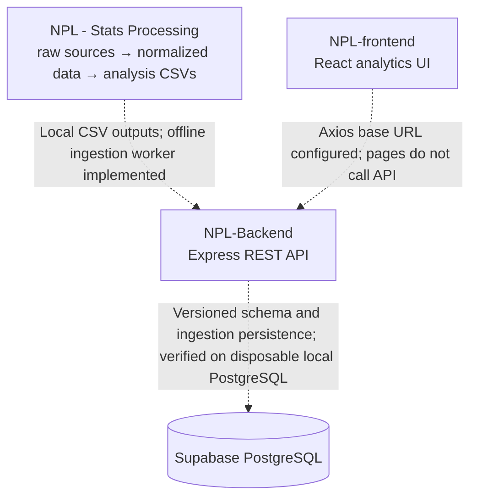

# NPL Cricket Analytics


**NPL Cricket Analytics** is a multi-project workspace for collecting and analyzing Nepal Premier League cricket data and, over time, presenting verified statistics in an interactive web application. A dedicated `ML/` scaffold has been added for future machine-learning work; model development and training have not started there.

The workspace contains three independently runnable projects:

1. **NPL - Stats Processing** — Python scripts and datasets for normalizing ball-by-ball and match data, calculating statistics, and exporting CSVs.
2. **NPL-Backend** — a TypeScript/Express API foundation with an optional server-side Supabase client.
3. **NPL-frontend** — a React dashboard prototype with league navigation, franchise assets, and pages for players, teams, matches, standings, and head-to-head comparisons.
4. **ML** — a starter Python package structure for future model workflows; it reads from the processing project by configurable paths and does not duplicate its datasets.

> **Current integration status:** These projects are not yet an operational end-to-end pipeline. The backend has an offline CSV ingestion worker and versioned Supabase schema. Migrations, synthetic persistence/rollback, cleanup, and anonymous/authenticated permission checks passed twice against disposable local PostgreSQL; hosted Supabase has not been modified. Delivery files that shrink are blocked, but same-row-count replacements cannot reliably reveal deletions, so a full import is not approved. The backend has no cricket-data read endpoints, and the frontend's Axios client is configured but not called by its pages. The frontend displays explicit placeholders rather than live league data.

## Contents

- [Project architecture](#project-architecture)
- [Current implementation status](#current-implementation-status)
- [Data inventory](#data-inventory)
- [Technology stack](#technology-stack)
- [Workspace structure](#workspace-structure)
- [Setup and execution](#setup-and-execution)
- [Development roadmap](#development-roadmap)
- [Long-term vision](#long-term-vision)

## Project architecture



| Layer | Responsibility | Verified state |
|---|---|---|
| Data processing | Gather source data, normalize ball-by-ball data, calculate match/player/team statistics, and export analysis CSVs. | A consolidated 2024–2025 ball-by-ball dataset and numerous derived reports exist. The available 2026/27 JSON archive is not included in that consolidated dataset. |
| Backend | Expose REST endpoints, validate requests, and provide controlled database access. | Express middleware, `GET /api/v1/health`, and an offline ingestion worker with a Supabase repository are implemented. Local PostgreSQL tests passed twice, including fixture teardown and authenticated/anonymous access denials. Shrinking source files are blocked pending a complete deletion policy. Cricket-data read endpoints are not implemented. |
| Database | Persist structured data for application queries. | Seven migrations are applied to the disposable local stack; catalog checks verified all 16 canonical tables have RLS, and five service-only RPCs have the expected grants/security mode. Schema lint and synthetic persistence/rollback checks passed. Hosted Supabase was not accessed. |
| Frontend | Present league data and analytics through responsive pages and visualizations. | The visual page structure, navigation, branding, team directory, and responsive styles exist. League records and statistics are placeholders; frontend pages do not make API requests. |
| Machine learning | Prepare data, build features, train and evaluate models, and retain resulting artifacts. | `ML/` contains an initial folder and starter-file scaffold only. Model development and training have not started; source datasets remain in the processing project. |

Solid arrows are intentionally not implied: the dashed connections are planned integration points, not currently working data flows.

## Current implementation status

### Completed

- **Processing:** raw CSV/JSON sources for multiple seasons are organized in the project; `data/processed/combined/merged_npl_2024_2025.csv` contains the normalized 2024–2025 delivery feed.
- **Processing:** analysis modules produce batting, bowling, fielding, extras, innings, match, team, points-table, head-to-head, advanced, and feature-engineering CSV outputs.
- **Processing:** a fail-fast data-quality assertion program is implemented for the 2024–2025 normalized master CSV and optionally the feature matrix. Its presence does not establish that all checks currently pass.
- **Backend:** strict TypeScript configuration, Zod environment parsing, Express setup, Helmet, CORS, JSON parsing, request logging, 404 handling, centralized error handling, and a health route are implemented.
- **Frontend:** the six routed views and shared dashboard shell are implemented. The visual system includes league/team branding, navigation, season selection, reusable cards, selectors, responsive CSS breakpoints, and reduced-motion handling.

### In progress / partial foundations

- The processing project contains a 2026/27 Cricsheet-format JSON season archive (12 match files), but the configured analysis loader and quality assertions target the 2024–2025 consolidated dataset.
- `src/ml_feature_engineering.py` builds a feature matrix, and `outputs/ml/npl_features.csv` is present. This is feature preparation, not a trained or evaluated prediction model.
- The backend has no cricket-data HTTP routes. Its offline ingestion worker supports CSV validation, season filtering, source reconciliation, and persistence calls.
- The backend's migrations, RPC grants/security mode, repository methods, and synthetic relationships/rollback have been checked against disposable local PostgreSQL. Removed source rows remain as historical canonical records; do not approve a full import until deletion/reconciliation policy is explicitly addressed. No hosted project has been modified.
- The frontend pages provide the intended layout and some interface controls, but live player, match, standings, and comparison data have not been connected.

### Planned / not implemented

- Explicit policy and implementation for reconciling source rows removed from changed files, followed by any required expanded readiness testing before a full import.
- REST endpoints for cricket statistics and frontend integration with those endpoints.
- Verified, populated analytics pages and historical season comparisons.
- Model training, evaluation, and prediction endpoints or UI.

## Data inventory

### Seasons and sources

The data-processing project contains source material for the following seasons:

| Season label in source files | Available data observed | Processing status |
|---|---|---|
| 2024/25 | 32 Cricsheet-format match JSON files; 2024 ball-by-ball CSV, match CSV, points-table JSON, and other source records. | The 2024 data is included in the consolidated 2024–2025 feed and analysis outputs. |
| 2025/26 | 32 Cricsheet-format match JSON files; 2025 ball-by-ball CSV, match summaries, player summaries, and points-table JSON. | The 2025 data is included in the consolidated 2024–2025 feed and analysis outputs. |
| 2026/27 | 12 Cricsheet-format match JSON files. | Raw archive only; not included in the configured consolidated feed. |

Raw data is retained under `NPL - Stats Processing/data/raw/`. This includes the season CSVs and JSON records, a source manifest, the Cricsheet match JSON archive, and checked-in source-repository/archive material. The raw files are not reproduced here.

### Consolidated and derived data

- **Delivery-level master:** `data/processed/combined/merged_npl_2024_2025.csv`. Each row represents a delivery and includes `match_id`, `season`, `match_number`, `inning`, batting/bowling teams, over/result, participants, dismissal fields, batter runs, extras, and total runs (22 columns). Deliveries relate to match-level records through `match_id`; a match contains multiple innings/deliveries.
- **Match-level input:** `data/raw/source/csv_data/NPL-matches.csv`, with identifiers, season/date/venue/stage, competing teams, toss/result, team totals, extras, outcome margin, and player of the match.
- **Source summaries:** season ball-by-ball CSVs (`NPL-2024.csv`, `NPL-2025.csv`), 2025 batting/bowling/match/player summaries, and JSON records including team/match information and season points tables.
- **Statistics:** generated CSVs are grouped into `outputs/advanced`, `batting`, `bowling`, `extras`, `fielding`, `head_to_head`, `innings`, `match`, `ml`, `points_table`, and `team`. Examples include player batting and bowling summaries, match and innings summaries, team season comparisons, head-to-head results, 2024/2025 points tables, data-quality summaries, and the ML feature matrix.

The raw source formats are not all identical: for example, the 2024 and 2025 delivery CSVs differ in identifier and batter/dismissal column names. The normalization script and consolidated schema are the intended common representation. No database schema currently formalizes these relationships.

## Technology stack

### Data processing

| Technology | Use |
|---|---|
| Python | Preprocessing, dataset loading, analysis, data-quality assertions, and feature engineering. |
| pandas | CSV ingestion, normalization, analysis, and report generation. |
| NumPy | Numeric and feature-engineering operations. |
| KaggleHub | Used by the optional Kaggle data-download script. |

The processing project has no root `requirements.txt` or `pyproject.toml`; Python package setup is described below using the imports present in the source.

### Backend

| Technology | Use |
|---|---|
| Node.js | Backend runtime. |
| TypeScript | Strictly configured server implementation. |
| Express 5 | HTTP application and routing. |
| Zod | Environment configuration validation. |
| `@supabase/supabase-js` | Optional server-side Supabase client. |
| Helmet, CORS, Morgan, dotenv | Security headers, cross-origin handling, request logging, and local environment loading. |

### Database

| Technology | State |
|---|---|
| Supabase PostgreSQL | A conditional Supabase JS client, 16-table schema, and ingestion RPC migrations exist. Migrations and synthetic persistence/rollback flows were verified on disposable local PostgreSQL; hosted Supabase has not been modified. |

### Frontend

| Technology | Use |
|---|---|
| React 19, React DOM | UI runtime. |
| Vite | Development server and production bundler. |
| TypeScript | Frontend source and build checks. |
| Tailwind CSS v4 with `@tailwindcss/vite` | Configured through the Vite plugin and CSS import; the application also has a substantial custom stylesheet. |
| React Router | Client-side page routes. |
| Lucide React | Interface icons. |
| Framer Motion | Page transitions and selected motion effects. |
| React Toastify | Toast container configured in the app. |
| Axios | Shared API client configured with a base URL; currently unused by the pages. |
| Recharts | Present as a dependency; no current page integration was found. |

## Workspace structure

Generated build directories and installed `node_modules` are omitted from the trees below. Raw datasets and third-party/source archives are represented by their important hierarchy rather than enumerated file-by-file.

```text
NPL Cricket Analytics/
├── .agents/                              # Workspace agent configuration
├── .aider-desk/                          # Workspace tooling/configuration
├── NPL - Stats Processing/
│   ├── analysis/
│   │   ├── batting/                      # Batting leaders and cross-season analysis
│   │   ├── bowling/                      # Bowling, wickets, wides, and no-ball analysis
│   │   ├── points_table/                 # 2024/2025 points-table calculations
│   │   ├── team/                         # Team records and head-to-head calculations
│   │   ├── common.py                     # Shared analysis data loading and output helpers
│   │   └── run_all.py                    # Main analysis CSV generation runner
│   ├── data/
│   │   ├── interim/                      # Intermediate-data location
│   │   ├── processed/
│   │   │   └── combined/
│   │   │       └── merged_npl_2024_2025.csv # Normalized 2024–2025 delivery feed
│   │   └── raw/
│   │       ├── cricsheet/npl_json/        # Match JSON archive, including 2024/25–2026/27
│   │       ├── source/csv_data/           # Season, match, and summary CSV inputs
│   │       ├── source/json_data/          # Match, team, and points-table JSON inputs
│   │       ├── source_repositories/       # Imported source repositories and user archive
│   │       └── source_manifest.json       # Raw-source inventory/metadata
│   ├── data_downloader/
│   │   └── kaggle_overall_data_download.py # Kaggle-oriented data download script
│   ├── data_provider/
│   │   └── data_provider.py               # Shared loader for the master delivery feed and match CSV
│   ├── docs/
│   │   ├── analysis_methodology.md         # Analysis inputs, execution, and output conventions
│   │   └── statistics_feasibility.md       # Statistics feasibility notes
│   ├── outputs/
│   │   ├── advanced/                      # Derived data quality and advanced analysis
│   │   ├── batting/                       # Batter summaries and records
│   │   ├── bowling/                       # Bowler summaries and records
│   │   ├── extras/                        # Extras by bowler, innings, and season
│   │   ├── fielding/                      # Catches, run-outs, and dismissals
│   │   ├── head_to_head/                  # Team and season comparisons
│   │   ├── innings/                       # Innings, phase, and over summaries
│   │   ├── match/                         # Match, venue, and season summaries
│   │   ├── ml/                            # Generated feature matrix
│   │   ├── points_table/                  # Season standings
│   │   └── team/                          # Team-level and season comparisons
│   ├── preprocessing/
│   │   └── all_season_data_normalized.py  # Multi-season normalization preprocessing
│   ├── src/
│   │   ├── cricket_stats.py               # Cricket-statistics calculations
│   │   ├── data_quality_assertions.py     # Data-quality validation CLI
│   │   ├── ml_feature_engineering.py      # Model-ready feature matrix generation
│   │   ├── normalize_master_csv.py        # Master CSV normalization utility
│   │   └── sanitize_json.py               # JSON sanitization utility
│   └── README.md                           # Processing-project setup and analysis notes
├── NPL-Backend/
│   ├── src/
│   │   ├── config/
│   │   │   ├── env.ts                     # Validated PORT/NODE_ENV/Supabase settings
│   │   │   └── supabase.ts                # Conditional server-side client creation
│   │   ├── controllers/                   # Empty controller scaffold
│   │   ├── middleware/
│   │   │   └── error-handler.ts           # Shared Express error response handler
│   │   ├── modules/                       # Empty cricket-domain module scaffold
│   │   ├── repositories/                  # Empty persistence scaffold
│   │   ├── routes/
│   │   │   └── health.routes.ts           # Health-check route
│   │   ├── services/                      # Empty application-service scaffold
│   │   ├── types/                         # Empty shared-types scaffold
│   │   ├── utils/                         # Empty utility scaffold
│   │   ├── app.ts                         # Express middleware and route registration
│   │   └── server.ts                      # HTTP server entry point
│   ├── .env.example                       # Backend environment variable names
│   ├── package.json                       # Dependencies and npm scripts
│   └── tsconfig.json                      # Strict TypeScript compiler settings
├── NPL-frontend/
│   ├── public/
│   │   ├── assets/branding/               # League and association identity assets
│   │   ├── assets/teams/                  # Eight franchise marks
│   │   ├── favicon.svg
│   │   └── icons.svg
│   ├── src/
│   │   ├── components/
│   │   │   ├── common/                    # Empty reserved component folder
│   │   │   ├── layout/                    # Empty reserved component folder
│   │   │   ├── sports/                    # Match, player, team, points-table, stat cards
│   │   │   └── ui/                        # Buttons, icons, selectors, headers, team marks
│   │   ├── constants/teams.ts             # Franchise identity and asset mapping
│   │   ├── hooks/                          # Empty hook scaffold
│   │   ├── layouts/DashboardLayout.tsx     # Shared header, navigation, and footer
│   │   ├── pages/
│   │   │   ├── Dashboard/DashboardPage.tsx
│   │   │   ├── HeadToHead/HeadToHeadPage.tsx
│   │   │   ├── Matches/MatchesPage.tsx
│   │   │   ├── Players/PlayersPage.tsx
│   │   │   ├── Standings/StandingsPage.tsx
│   │   │   └── Teams/TeamsPage.tsx
│   │   ├── routes/AppRoutes.tsx            # Browser route definitions
│   │   ├── services/api.ts                 # Axios client and API base URL
│   │   ├── types/                          # Empty reserved type folder
│   │   ├── utils/                          # Empty reserved utility folder
│   │   ├── App.css                         # Application component and responsive styles
│   │   ├── App.tsx                          # Router and toast container
│   │   ├── index.css                        # Tailwind import and global styles
│   │   └── main.tsx                         # React entry point
│   ├── docs/asset-attribution.md           # Branding and team-mark sources/notes
│   ├── .env.example                        # Frontend API-base variable name
│   ├── package.json                        # Dependencies and npm scripts
│   └── vite.config.ts                      # React and Tailwind Vite plugins
├── ML/
│   ├── configs/                             # Dataset paths and reserved workflow settings
│   ├── data/                                # ML-specific data locations; source data stays in processing project
│   ├── notebooks/                           # Future exploration notebooks
│   ├── src/                                 # Starter packages for data, features, models, training, evaluation
│   ├── artifacts/                           # Future generated models and metrics
│   ├── tests/                               # Future ML tests
│   ├── scripts/                             # Future workflow entry points
│   └── requirements.txt                     # Initial ML dependencies; not installed
├── run_backend.bat                          # Starts backend development server
├── run_frontend.bat                         # Starts frontend development server
└── skills-lock.json                         # Workspace skills metadata
```

The backend directory is named **`NPL-Backend`** in this workspace. The frontend's empty `common`, `layout`, `hooks`, `types`, and `utils` folders and the backend's empty domain scaffolds are placeholders, not evidence of implemented functionality.

## Setup and execution

Run each application from its own project directory. The root batch files are convenience launchers for the backend and frontend only; there is no root-level application orchestrator.

### Data processing

**Prerequisites:** Python and pip. The project root currently has no dependency manifest. The source imports pandas and NumPy; install the packages required by the scripts you run in an isolated environment.

From PowerShell:

```powershell
Set-Location "NPL - Stats Processing"
python -m venv .venv
.\.venv\Scripts\Activate.ps1
python -m pip install pandas numpy kagglehub
```

Run the analysis and data-quality checks from the processing project root:

```powershell
python -m analysis.run_all
python src\data_quality_assertions.py
```

Optional ML feature generation and its corresponding validation:

```powershell
python src\ml_feature_engineering.py
python src\data_quality_assertions.py --features-csv outputs\ml\npl_features.csv
```

The analysis runner reads `data/processed/combined/merged_npl_2024_2025.csv` and `data/raw/source/csv_data/NPL-matches.csv`; derived reports are written under `outputs/`. Feature engineering reads the normalized master CSV and writes `outputs/ml/npl_features.csv` by default. These commands do not connect to Supabase.

### Backend

**Prerequisites:** Node.js and npm.

```powershell
Set-Location NPL-Backend
npm install
Copy-Item .env.example .env
```

The example defines `PORT` (defaults to `5000`), `NODE_ENV` (defaults to `development`), `SUPABASE_URL`, and `SUPABASE_SERVICE_ROLE_KEY`. Supabase settings are optional for the health route. Use your own project credentials in the local `.env`; never commit the service-role key or put it in frontend configuration.

```powershell
npm run dev       # Development server with watch mode
npm run typecheck # Type-check without emitting files
npm run build     # Compile TypeScript to dist/
npm start         # Run the compiled server
```

Implemented endpoint:

| Method | Path | Purpose |
|---|---|---|
| `GET` | `/api/v1/health` | Returns a JSON success message confirming the API is running. |

No player, team, match, statistics, or database endpoints are currently implemented.

### Frontend

**Prerequisites:** Node.js and npm.

```powershell
Set-Location NPL-frontend
npm install
Copy-Item .env.example .env
```

`VITE_API_BASE_URL` defaults in the API client to `http://localhost:5000/api/v1`. It can be overridden in the local `.env`, but the current pages do not call that client.

```powershell
npm run dev     # Start Vite development server
npm run build   # Type-check and create production build
npm run preview # Preview the production build
npm run lint    # Run ESLint
```

The frontend routes are `/` (dashboard), `/players`, `/teams`, `/matches`, `/standings`, and `/head-to-head`. The root `run_backend.bat` and `run_frontend.bat` scripts each run the corresponding project's `npm run dev`.

## Development roadmap

Checkboxes mark implementation verified in this workspace, not end-to-end acceptance or data correctness. Unchecked work is not currently implemented.

### Phase 1 — Data collection and processing

- [x] Organize multiple raw historical data sources, including 2024/25, 2025/26, and a partial 2026/27 JSON archive.
- [x] Normalize and consolidate the 2024 and 2025 delivery datasets.
- [x] Generate multi-season batting, bowling, team, match, fielding, innings, and head-to-head reports.
- [x] Provide a data-quality assertion suite and feature-engineering script.
- [ ] Integrate the 2026/27 raw matches into a normalized and validated master feed.
- [ ] Establish repeatable data-quality results for each source and generated dataset.
- [ ] Define and verify database-ready import schemas and stable identifiers.

### Phase 2 — Backend and database

- [x] Establish the Express/TypeScript application and a versioned health endpoint.
- [x] Configure optional Supabase client creation from server environment variables.
- [x] Design the Supabase PostgreSQL schema and write sequential migrations.
- [x] Apply and validate migrations on a disposable local Supabase stack; verify RPCs and database constraints.
- [x] Implement the offline ingestion worker and mocked persistence tests; synthetic PostgreSQL integration is verified locally.
- [ ] Add REST endpoints for players, teams, matches, standings, and analytics.
- [x] Add and run PostgreSQL integration tests for synthetic persistence, rollback, idempotency, and retry behavior.
- [ ] Resolve removed-source-row reconciliation policy before full data import approval.

### Phase 3 — Frontend

- [x] Build the shared dashboard shell, navigation, responsive visual styles, and six route views.
- [x] Add sourced league/franchise asset files and reusable cricket UI components.
- [ ] Connect the frontend to backend responses and replace placeholders with verified data.
- [ ] Implement functional player statistics, match center, standings, and head-to-head comparisons.
- [ ] Add data-backed charts and historical season comparisons.
- [ ] Validate responsive behavior with populated real datasets and supported devices.

### Phase 4 — Machine learning

- [x] Add an ML-only folder/package scaffold, dependency list, and configurable references to existing processed datasets.
- [x] Implement feature engineering for match phase, innings context, chase state, and player rolling/career features.
- [ ] Implement the ML workspace data-loading and preprocessing workflow.
- [ ] Implement the ML workspace feature, training, and evaluation stages.
- [ ] Define prediction targets and prepare leakage-safe training/validation datasets.
- [ ] Train and evaluate match-outcome prediction models.
- [ ] Train and evaluate player-performance prediction models.
- [ ] Integrate evaluated predictions into the API and dashboard with clear uncertainty and limitations.

## Long-term vision

The objective is a complete Nepal Premier League analytics platform that combines:

1. Reliable, traceable historical cricket data.
2. Detailed player and team statistics.
3. Interactive analytics dashboards and match information.
4. Historical season comparisons.
5. Carefully evaluated machine-learning-based match and player predictions.
6. Useful, evidence-based cricket insights.

Machine learning is a future objective. The current feature-engineering code and feature CSV are preparatory work; there is no verified trained or evaluated prediction model in the workspace.
