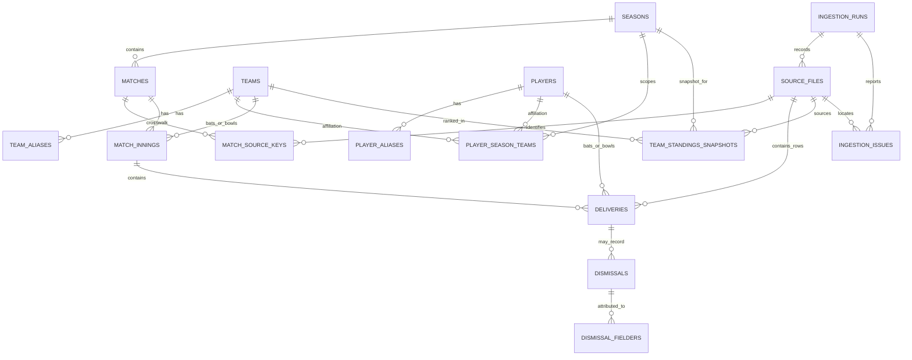

# NPL Insights Database Architecture

**Status:** The initial database foundation is versioned in
`NPL-Backend/supabase/migrations/`. Those migrations have not been applied to a
local or hosted database. No application code or dataset was modified.

## 1. Current-state assessment

The workspace is a set of separate projects, not an end-to-end running platform:

- **`NPL - Stats Processing/`** holds the raw archives, the consolidated
  2024–2025 delivery CSV, analysis code, generated CSV reports, and a separate
  feature-engineering workflow. Processing uses local files and does not connect
  to Supabase.
- **`NPL-Backend/`** is an Express 5/TypeScript scaffold. It has environment
  parsing, security/logging middleware, centralized error handling, and
  `GET /api/v1/health`. Its Supabase JS client is created conditionally from
  `SUPABASE_URL` and `SUPABASE_SERVICE_ROLE_KEY`; there are no database
  repositories, queries, cricket endpoints, or ingestion code yet. The initial
  relational schema is now versioned under `supabase/migrations/`, but has not
  been applied to a database.
- **`NPL-frontend/`** has six routed placeholder pages and an Axios client, but
  the pages do not call the API. Team marks/names and season selection are
  static. Its selector offers 2024, 2025, and 2026 and defaults to 2026.
- **`ML/`** is a separate scaffold. Its loader is unimplemented, and its YAML
  points at the processing project's master delivery and match CSVs. Model
  training has not started there.

### Observed source formats

The actual processed master,
`NPL - Stats Processing/data/processed/combined/merged_npl_2024_2025.csv`,
has 22 columns:

```text
match_id, season, match_number, inning, batting_team, bowling_team,
ball_over, ball_result, bowler, batsman, non_striker, shot_direction,
player_out, dismissal_kind, fielders, batsman_runs, wide_runs, bye_runs,
legbye_runs, noball_runs, extra_runs, total_runs
```

`season` and `match_number` are added by the normalization step. The 2024 and
2025 source feeds use different names for match ID, striker, dismissed player,
and fielder (`match_id`/`match_no`, `batsman`/`batter`,
`player_dismissed`/`player_out`, `fielder`/`fielders`). The existing merge
prefixes local IDs with season/source prefixes, but that ID is not a verified
global match identity.

`data/raw/source/csv_data/NPL-matches.csv` has 30 columns:

```text
id, season, date, time, venue, stage, city, team_1, team_2, toss_winner,
toss_decision, result, dls_applied, super_over, winner, team_1_runs,
team_2_runs, team_1_overs_played, team_2_overs_played, team_1_wickets,
team_2_wickets, team_1_runs_from_extra, team_2_runs_from_extra, win_by_runs,
win_by_wickets, player_of_the_match, over_balls, extra_balls,
total_ball_bowled
```

The current `preprocessing/all_season_data_normalized.py` script references
`data/raw/source_repositories/user_provided_archive/NPL-2024.csv` and
`NPL-2025.csv`; those two paths are absent in the inspected workspace. Files
with the corresponding names and observed schemas are present under
`data/raw/source/csv_data/`. This path mismatch must be resolved when planning
a reproducible source rebuild; the architecture does not change either path.

The 2025 source summaries have these observed headers:

- `npl_2025_batting_summary.csv`: `match, teamInnings, battingPos,
  batsmanName, runs, balls, 4s, 6s, SR, out/not_out, match_id`
- `npl_2025_bowling_summary.csv`: `match, bowlingTeam, bowlerName, overs,
  maiden, runs, wickets, economy, 0s, 4s, 6s, wides, noBalls, match_id`
- `npl_2025_match_summary.csv`: `MatchDate, Team1, Team2, Winner, Margin,
  Ground, match_id`
- `npl_2025_players_summary.csv`: `name, team, battingStyle, bowlingStyle,
  playingRole, description`

The 2024 and 2025 points-table JSON rows contain `rank`, `team`,
`matches_played`, `wins`, `losses`, `nrr`, and `points`. The processing scripts
derive `nr = matches_played - wins - losses` and sort by points then NRR for
the CSV export. A Cricsheet-format archive includes 2024 and 2025 files and 12
2026/27 files; the archive uses nested `info`, `innings`, `overs`, and
`deliveries` structures. That archive is not the current consolidated master
feed.

### Data-quality and identity risks observed in project documentation/code

Treat these as reconciliation tasks, not as clean data guarantees:

1. The processing methodology documents duplicate 2025 match-table IDs,
   including a key collision; one 2024 match has a one-run difference between
   the delivery and match feeds. Match-level identifiers and scorecards must
   be crosswalked before import.
2. The methodology reports a `Gorkhas`/`Gurkhas` team spelling difference
   between sources. Team aliases are not currently canonicalized.
3. There are repeated `(match_id, inning, ball_over)` labels, which can be
   legitimate for wides/no-balls, and documented exact duplicate instances.
   The existing label is not a unique delivery key. Do not silently drop
   records based on it.
4. The normalized feed lowercases names and fills some numeric nulls with zero.
   That is useful for current reports but can erase distinctions between
   unknown and confirmed zero. Preserve raw inputs and validate null meaning
   before canonical loading.
5. The existing quality assertions target 2024/25 and make T20-specific
   assumptions (including innings 1/2 and at most 120 legal balls). They do
   not certify the 2026/27 archive or every source.
6. Fielders can be ambiguous/multiple names in one source cell. A fielder's
   credit must not be inferred by assigning the whole string to one player.
7. Player roles/affiliations are incomplete: the 2025 player summary contains
   role/style fields, but it does not establish a verified all-season roster.
8. The current merge script's referenced `user_provided_archive` CSV paths are
   absent, while same-named season CSVs are present under `source/csv_data`.
   Their equivalence and provenance should be confirmed before treating them
   as interchangeable.

These observations come from the inspected project files and its documented
validation notes; this architecture proposal has not run the pipeline or
independently certified every source row.

## 2. Database design rationale

Use PostgreSQL relational tables as the canonical event store. Treat CSV/JSON
files as versioned source inputs, not as separate competing production
databases. Use generated UUIDs for canonical entities and retain source IDs in
crosswalk tables. This allows source IDs to collide or change without changing
historical canonical relationships.

Normalize stable entities (season, team, player), match metadata, innings,
deliveries, dismissals, and provenance. Do not persist the many repeated
analysis exports as tables: derive player/team/match statistics from deliveries,
dismissals, and verified match results. Use materialized views only after query
plans/load measurements show a regular view is too slow. Store official
standings as source snapshots because NRR and points rules are source-defined
and cannot safely be inferred from the current incomplete match records.

Canonical names are display values, not identity keys. An alias must be
reviewed before it maps to an existing player/team. Do not use global
case-folded player name as a unique key: different players can share names,
and spelling/transliteration changes can represent the same player.

### Entity relationship diagram



`PLAYER_MATCH_PERFORMANCES`, batting/bowling/fielding statistics, innings and
match aggregates, and head-to-head are initially **views**, not base tables.
Add a materialized view and refresh strategy only if measured latency warrants
it. ERD omits those derived views for readability.

## 3. Table-by-table schema specification

Types below are PostgreSQL types. `id uuid` columns use
`gen_random_uuid()` as the proposed default. Names are lowercase snake_case.
All foreign-key columns should have supporting indexes where no primary or
unique index already supplies one. The initial migration implementation is
documented in `NPL-Backend/supabase/README.md`; it has not yet been applied.

### Canonical entities

| Table / purpose | Columns (type; `PK`, `FK`, `UQ` noted) | Constraints, indexes, relationships |
|---|---|---|
| `seasons` — competition-season dimension | `id uuid PK`; `season_key text UQ NOT NULL` (e.g. `2024/25`); `label text NOT NULL`; `source_season_year smallint NULL`; `start_date date NULL`; `end_date date NULL`; `coverage_status text NOT NULL` (`unknown`, `partial`, `complete`); `created_at timestamptz NOT NULL` | Unique `season_key`; check end date is not before start date. Parent of matches, player-team affiliations, and standing snapshots. Keep source year separate from public season label; source feeds may encode season as a year only. |
| `teams` — stable franchise identity | `id uuid PK`; `team_key text UQ NOT NULL`; `canonical_name text UQ NOT NULL`; `short_name text NULL`; `active boolean NOT NULL DEFAULT true`; `created_at timestamptz NOT NULL` | Unique stable key and canonical display name. Parent of aliases, affiliations, innings, and standings. Do not use an image URL or display spelling as the identity key. |
| `team_aliases` — source-specific team-name crosswalk | `id uuid PK`; `team_id uuid FK NOT NULL`; `source_system text NOT NULL`; `alias text NOT NULL`; `alias_normalized text NOT NULL`; `created_at timestamptz NOT NULL` | Unique `(source_system, alias_normalized)` after collisions are reviewed; index `team_id`. A source alias such as an alternate Kathmandu spelling maps to one team only after confirmation. |
| `players` — stable player identity | `id uuid PK`; `display_name text NOT NULL`; `sort_name text NULL`; `created_at timestamptz NOT NULL` | Index `display_name` for directory/search (use a suitable trigram index only if substring search is required). Do **not** make display name globally unique. Parent of aliases, affiliations, deliveries, awards, and dismissals. |
| `player_aliases` — source-specific player-name crosswalk | `id uuid PK`; `player_id uuid FK NOT NULL`; `source_system text NOT NULL`; `alias text NOT NULL`; `alias_normalized text NOT NULL`; `created_at timestamptz NOT NULL` | Unique `(source_system, alias_normalized)` for accepted aliases; index `player_id`. An ambiguous alias stays unresolved in staging instead of being assigned by fuzzy matching. |
| `player_season_teams` — verified season roster/profile association | `season_id uuid FK NOT NULL`; `team_id uuid FK NOT NULL`; `player_id uuid FK NOT NULL`; `playing_role text NULL`; `batting_style text NULL`; `bowling_style text NULL`; `source_file_id uuid FK NULL` | PK `(season_id, team_id, player_id)`; indexes `(season_id, team_id)` and `(season_id, player_id)`. Holds season/team-specific profile facts, not an assumption that player identity or roster is the same every season. Populate only from a reviewed roster/profile source. |

### Match and ball-by-ball facts

| Table / purpose | Columns (type; `PK`, `FK`, `UQ` noted) | Constraints, indexes, relationships |
|---|---|---|
| `matches` — canonical match metadata and result | `id uuid PK`; `season_id uuid FK NOT NULL`; `match_number integer NULL`; `match_date date NULL`; `start_time time NULL`; `venue_name text NULL`; `city text NULL`; `stage text NULL`; `team_a_id uuid FK NULL`; `team_b_id uuid FK NULL`; `toss_winner_team_id uuid FK NULL`; `toss_decision text NULL`; `winner_team_id uuid FK NULL`; `result_text text NULL`; `win_by_runs integer NULL`; `win_by_wickets integer NULL`; `dls_applied boolean NULL`; `super_over boolean NULL`; `player_of_match_id uuid FK NULL`; `match_status text NOT NULL DEFAULT 'unknown'`; `created_at timestamptz NOT NULL`; `updated_at timestamptz NOT NULL` | Index `(season_id, match_date DESC)`, each team FK, `winner_team_id`, and `venue_name` if used for filtering. Check non-negative margins; if both teams are present they differ; if winner/toss winner is present it must be one of the two teams. Do not unique `(season_id, match_number)` until source collisions are resolved. |
| `match_source_keys` — source-to-canonical match crosswalk | `id uuid PK`; `match_id uuid FK NULL`; `source_file_id uuid FK NOT NULL`; `source_system text NOT NULL`; `source_season_key text NOT NULL` (empty string only when absent); `external_match_key text NOT NULL`; `disambiguator text NOT NULL DEFAULT ''`; `source_row_number bigint NOT NULL`; `resolution_status text NOT NULL` (`resolved`, `ambiguous`, `rejected`) | Unique `(source_file_id, source_row_number)`; `match_id` is required only when `resolution_status = 'resolved'`; a partial unique index applies `(source_system, source_season_key, external_match_key, disambiguator)` only to resolved keys; index `(source_system, external_match_key)`. This nullable FK is an implementation clarification so ambiguous/rejected source rows can be preserved without an invented canonical match. Disambiguators must be stable/reviewed (season/team/date crosswalk), not guessed from a duplicate row. |
| `match_innings` — innings identity and batting/bowling sides | `match_id uuid FK NOT NULL`; `innings_no smallint NOT NULL`; `batting_team_id uuid FK NULL`; `bowling_team_id uuid FK NULL`; `is_super_over boolean NOT NULL DEFAULT false`; `source_file_id uuid FK NULL` | PK `(match_id, innings_no)`; check `innings_no > 0`; indexes batting and bowling team IDs. Supports innings beyond 1/2, including super overs. The table stores the innings identity and teams; totals are derived from deliveries or reconciled from source summaries. |
| `deliveries` — ordered ball-by-ball source facts | `id bigint GENERATED ALWAYS AS IDENTITY PK`; `match_id uuid NOT NULL`; `innings_no smallint NOT NULL`; `delivery_no integer NOT NULL`; `source_file_id uuid FK NOT NULL`; `source_row_number bigint NOT NULL`; `over_number smallint NULL`; `ball_in_over smallint NULL`; `source_ball_label text NULL`; `ball_result text NULL`; `shot_direction text NULL`; `bowler_id uuid FK NULL`; `batter_id uuid FK NULL`; `non_striker_id uuid FK NULL`; `bowler_name_raw text NULL`; `batter_name_raw text NULL`; `non_striker_name_raw text NULL`; `batter_runs smallint NULL`; `wide_runs smallint NULL`; `no_ball_runs smallint NULL`; `bye_runs smallint NULL`; `leg_bye_runs smallint NULL`; `extra_runs smallint NULL`; `total_runs smallint NULL` | FK `(match_id, innings_no)` to innings; unique `(match_id, innings_no, delivery_no)`; unique `(source_file_id, source_row_number)` within the imported source file; indexes `(batter_id, match_id)`, `(bowler_id, match_id)`, and `non_striker_id`. Non-negative numeric checks where known. `delivery_no` is source order, not a parsed over-ball label. Preserve raw name strings for unresolved identity/audit. Unknown numeric values remain NULL until confirmed; zero means known zero. |
| `dismissals` — normalized wicket events | `id bigint GENERATED ALWAYS AS IDENTITY PK`; `delivery_id bigint FK NOT NULL`; `dismissal_no smallint NOT NULL`; `player_out_id uuid FK NULL`; `player_out_name_raw text NULL`; `dismissal_kind text NOT NULL`; `source_file_id uuid FK NULL` | Unique `(delivery_id, dismissal_no)`; index `(player_out_id)` and `(dismissal_kind)`. Supports multiple dismissals on one delivery even though the current consolidated CSV has one `player_out` field. Do not credit all dismissals to a bowler; dismissal-kind rules determine that derived statistic. |
| `dismissal_fielders` — resolved/raw fielder attribution per dismissal | `dismissal_id bigint FK NOT NULL`; `fielder_no smallint NOT NULL`; `player_id uuid FK NULL`; `fielder_name_raw text NOT NULL` | PK `(dismissal_id, fielder_no)`; index `player_id`. Preserve attribution as sourced; unknown or multi-player text must not be silently split or credited. |

### Source provenance and official standings

| Table / purpose | Columns (type; `PK`, `FK`, `UQ` noted) | Constraints, indexes, relationships |
|---|---|---|
| `ingestion_runs` — one auditable execution of an import | `id uuid PK`; `started_at timestamptz NOT NULL`; `finished_at timestamptz NULL`; `status text NOT NULL` (`running`, `succeeded`, `completed_with_errors`, `failed`); `pipeline_version text NOT NULL`; `source_set text NOT NULL`; `rows_read bigint NOT NULL DEFAULT 0`; `rows_inserted bigint NOT NULL DEFAULT 0`; `rows_updated bigint NOT NULL DEFAULT 0`; `rows_unchanged bigint NOT NULL DEFAULT 0`; `rows_rejected bigint NOT NULL DEFAULT 0`; `summary jsonb NOT NULL DEFAULT '{}'` | Index `(started_at DESC)` and status. Counters are run-level audit data, not cricket facts. JSON is limited to operational summary data, not a substitute for relational match records. |
| `source_files` — immutable source-file provenance and fingerprint | `id uuid PK`; `ingestion_run_id uuid FK NOT NULL`; `source_system text NOT NULL`; `logical_path text NOT NULL`; `content_sha256 char(64) NOT NULL`; `format text NOT NULL`; `season_id uuid FK NULL`; `row_count bigint NULL`; `loaded_at timestamptz NOT NULL` | Unique `(ingestion_run_id, source_system, content_sha256)`; non-unique lookup index `(source_system, content_sha256)`; indexes `(ingestion_run_id)` and `(season_id, source_system)`. Stores identity/metadata for a source file, not its full raw contents. |
| `ingestion_issues` — row/file-level validation and reconciliation errors | `id bigint GENERATED ALWAYS AS IDENTITY PK`; `ingestion_run_id uuid FK NOT NULL`; `source_file_id uuid FK NULL`; `source_row_number bigint NULL`; `entity_name text NULL`; `source_key text NULL`; `severity text NOT NULL` (`warning`, `error`, `blocking`); `issue_code text NOT NULL`; `column_name text NULL`; `message text NOT NULL`; `created_at timestamptz NOT NULL` | Index `(ingestion_run_id, severity)` and `(source_file_id, source_row_number)`. Keep error messages actionable and avoid storing whole source rows in issue text. |
| `team_standings_snapshots` — imported official/source standings by version | `id uuid PK`; `season_id uuid FK NOT NULL`; `team_id uuid FK NOT NULL`; `snapshot_key text NOT NULL` (e.g. final/dated source version); `snapshot_date date NULL`; `rank smallint NULL`; `matches_played smallint NULL`; `wins smallint NULL`; `losses smallint NULL`; `no_results smallint NULL`; `net_run_rate numeric NULL`; `points smallint NULL`; `source_file_id uuid FK NULL`; `recorded_at timestamptz NOT NULL` | Unique `(season_id, team_id, snapshot_key)`; index `(season_id, rank)`. Unconstrained `numeric` preserves source NRR precision until its scale is confirmed. Null means not supplied/verified, not zero. Import the source snapshot and its provenance; compare with match-derived standings rather than silently replacing it. |

### Derived views, not duplicate base tables

| View (initially regular views) | Grain and source | Important rules |
|---|---|---|
| `v_innings_summary` | One match/innings; deliveries and dismissals | Sum total runs, batter runs, extras, legal balls, boundaries, and wickets. Exclude retired hurt from wickets lost where verified. |
| `v_player_match_performance` | One match/player with recorded batting or bowling participation | Aggregate batting and bowling contributions separately. A player with zero deliveries cannot be inferred as an appearance without verified lineups. |
| `v_batting_statistics` | Player/season and player/match/innings | Runs are `batter_runs`; balls faced exclude wides and include no-balls; fours/sixes use batter runs; average requires an agreed dismissal denominator and minimum sample threshold. |
| `v_bowling_statistics` | Bowler/season and bowler/match/innings | Runs conceded are batter runs + wides + no-ball runs; legal balls exclude wides and no-balls; bowler wickets exclude run-outs and other non-credited dismissals. |
| `v_fielding_statistics` | Fielder/season, dismissal kind and match | Build only from resolved `dismissals` and `dismissal_fielders`; never assign ambiguous strings to a single player. |
| `v_team_statistics` | Team/season and team/match | Derive from innings/deliveries and verified match outcomes. Keep batting, bowling, wins, and no-results semantics explicit. |
| `v_head_to_head` | Canonically ordered team pair, optionally season | Aggregate canonical match outcomes and innings. Team pair ordering is stable; result-only summaries should not mix with score aggregates from incomplete matches. |
| `v_standings_calculated` | Team/season | Only calculate when match coverage and competition points/qualification rules are confirmed. NRR cannot be inferred from current summary fields alone. Compare with official snapshots. |

`security_invoker` should be used for any exposed PostgreSQL view on a
PostgreSQL version that supports it; otherwise keep analytics views out of
untrusted access paths or grant access only through the backend. The initial
migrations enable RLS on all 16 tables, add no RLS policies, revoke table and
identity-sequence access from `PUBLIC`, `anon`, and `authenticated`, and grant
the backend-only `service_role` access. This deliberately denies Data-API
access to normal client roles until a public read policy is approved. The
service-role key remains server-only. Any future policy or public grant
requires an explicit access-model review.

## 4. CSV-to-database mapping

### Source inputs

| File(s) | Observed columns / shape | Mapping and disposition | Data checks / caveats |
|---|---|---|---|
| `data/raw/source/csv_data/NPL-2024.csv` | `match_id, inning, batting_team, bowling_team, ball_over, ball_result, bowler, batsman, non_striker, shot_direction, player_dismissed, dismissal_kind, fielder, batsman_runs, wide_runs, bye_runs, legbye_runs, noball_runs, extra_runs, total_runs` | Candidate source. Stage first. Rename `player_dismissed` to dismissed-player input and `fielder` to fielders; resolve source match ID to canonical match; create innings and ordered deliveries. The current merge script references a different (currently missing) `user_provided_archive` path. | Confirm this file is the same source/version as the script's referenced input before rebuild. Match ID is season-local; retain source row order. Preserve raw names and nulls. |
| `data/raw/source/csv_data/NPL-2025.csv` | `match_no, inning, batting_team, bowling_team, ball_over, ball_result, bowler, batter, non_striker, shot_direction, player_out, dismissal_kind, fielders, batsman_runs, wide_runs, bye_runs, legbye_runs, noball_runs, extra_runs, total_runs` | Candidate source. Stage first. Map `match_no` and `batter` to canonical source-key/striker fields; map `player_out`/`fielders`; resolve to the same canonical model as 2024. The current merge script references a different (currently missing) `user_provided_archive` path. | Confirm source equivalence before rebuild. Do not assume a `match_no` is globally unique. Compare aliases and delivery totals with match sources. |
| `data/processed/combined/merged_npl_2024_2025.csv` | 22 master columns listed in §1 | Preferred first historical delivery import after revalidation. `match_id` is an external key, `season`/`match_number` are crosswalk hints, `inning` maps to `match_innings`, delivery row order determines `delivery_no`. | This is processed output, not authoritative identity proof. Recheck all numeric components and source null semantics; preserve raw file hash and line numbers. |
| `data/raw/source/csv_data/NPL-matches.csv` | 30 columns listed in §1 | Stage and normalize into `matches`, `match_source_keys`, and team/player aliases. Parse date/time, result, DLS/super-over, scores, margins, toss, and player of match. Venue/city/stage remain text initially. | Match ID collisions and a documented one-run score disagreement block blind upsert. Use a reviewed crosswalk. The foundation stores the immutable source-file fingerprint/path, not duplicate per-source scorecards; reconciliation must retain differences in ingestion issues or a future source-fact table if queryable score history is required. |
| `data/raw/source/csv_data/npl_2025_batting_summary.csv` | Columns listed in §1 | Do not load as canonical batting facts. Use as an independent comparison for runs, balls, boundaries, strike rate, dismissal/not-out status, and match mapping. | `out/not_out`, `teamInnings`, `battingPos`, and unit conventions need explicit parsing/validation. Source is one season only. |
| `data/raw/source/csv_data/npl_2025_bowling_summary.csv` | Columns listed in §1 | Do not load as canonical bowling facts. Compare derived bowler/innings figures against delivery aggregates. | Overs may be decimal-looking cricket notation, not decimal fractions; reconcile legal balls and extra rules. |
| `data/raw/source/csv_data/npl_2025_match_summary.csv` | Columns listed in §1 | Cross-check `matches` date, teams, winner, margin, and ground; map `match_id` only after resolving source IDs. | Text date/margin parsing and duplicate IDs require review. |
| `data/raw/source/csv_data/npl_2025_players_summary.csv` | Columns listed in §1 | Candidate source for `players`, `player_aliases`, and `player_season_teams`; import only after team/player aliases and roster semantics are reviewed. | A 2025 profile does not prove a player was rostered in all seasons or played a match. |
| `data/raw/source/json_data/2024_points_table.json`, `2025_points_table.json` | `rank, team, matches_played, wins, losses, nrr, points` per observed row | Stage and import as `team_standings_snapshots`; derive `no_results` as matches minus wins/losses only if source semantics are verified; preserve original values. | The export adds `nr` using that subtraction and sorts by points then NRR. No snapshot date is present in the observed row shape. |
| `data/raw/cricsheet/npl_json/*.json` | Cricsheet-style `info` (including dates, event, teams, toss, outcome, venue, player lists), `innings` → `overs` → `deliveries`, with nested runs/extras/wickets when present | Keep as a separate source adapter. Map match metadata and delivery events only after matching the source ID/file name to a canonical match and reconciling event semantics. Retain raw file name/key in `match_source_keys`. | 2024/25 overlaps existing data and must not be double-counted. The 2026/27 set is partial. Verify legality, dismissal and over numbering against current CSV semantics. |
| `data/raw/source/json_data/matches.json`, `teams.json`, `npl_api.json`, `npl_data_2024.json` | `teams.json` records expose `id`, `name`, `marquee_player`, `players`; `matches.json` has a custom `match1` wrapper in the inspected first record. Other nested schemas were not treated as canonical. | Stage and profile before mapping. `teams.json` can inform team/alias/roster mapping after cross-checking; match JSON is not directly ingested until its full record shape and ID semantics are documented. | Do not infer the full schema from a representative item. Confirm all rows and source-version changes before using them. |
| `data/raw/source_repositories/Diwash17_Nepal-Premier-League-Data/ball_by_ball.csv` | `match_no, inning, date, batting_team, bowling_team, over, ball, batter, bowler, non_striker, batsman_runs, extra_runs, total_runs, extras_type, is_wicket, player_dismissed, dismissal_kind, fielder` | Alternate raw-delivery source; requires mapping `over`/`ball` to ordered source labels and classifying `extras_type`. Keep separate until overlap with the normalized feed is measured. | No single stable delivery key is visible in the header; the source's row order and `is_wicket` semantics require validation. |
| `data/raw/source_repositories/Diwash17_Nepal-Premier-League-Data/NPL_Season2_ball_by_ball_data.csv` | `match_no, inning, batting_team, bowling_team, ball_over, ball_result, bowler, batter, non_striker, shot_direction, player_out, dismissal_kind, fielders, batsman_runs, wide_runs, bye_runs, legbye_runs, noball_runs, extra_runs, total_runs` | Alternate normalized-looking delivery source. Stage separately and map through the same crosswalk; do not merge on matching headers alone. | Establish season coverage, identity/source provenance, and overlap before accepting it. |
| `data/raw/source_repositories/Diwash17_Nepal-Premier-League-Data/Nepal_Premier_League.csv` | `t, team_1, team_2, season, player_of_the_match, toss_winner, toss_decision, target, winner_team, won_by_margin, umpire_1, umpire_2, tv_umpire, match_referee` | Candidate match metadata source; no direct import until the meaning/type of `t`, match key, target, and margin semantics are established. | Header alone does not establish a match date or unique match ID. |
| `data/raw/source_repositories/thebinodd_data-analysis-of-NPL/fastapi-backend/datasets/NPL-2024.csv`, `NPL-2025.csv` | Same respective 2024/2025 season headers listed above | Alternate copies; use for comparison/provenance only until byte-level/source-lineage comparison confirms equivalence. | Potential overlap with the candidate season CSVs and consolidated feed. |
| `data/raw/source_repositories/thebinodd_data-analysis-of-NPL/fastapi-backend/datasets/npl_dataset.csv` | `t, match_id, inning, batting_team, bowling_team, ball_over, ball_result, bowler, batsman, non_striker, shot_direction, player_dismissed, dismissal_kind, fielder, batsman_runs, wide_runs, bye_runs, legbye_runs, noball_runs, extra_runs, total_runs` | Alternate feed; profile `t` and its relationship to `match_id`, then stage as a distinct source if needed. | Do not drop the extra `t` field or assume it is a date without examining values/lineage. |
| `data/raw/source_repositories/**` and `user_provided_archive/**` other files/archives | Preserved notebooks, code, documentation, and `archive.zip` | Archive and provenance only until source inventory, lineage, format, and duplicate overlap are assessed. Select one agreed authority per canonical fact. | Never concatenate all archived copies; that would create overlapping records and untraceable precedence. |

### Generated CSV exports

Generated files are **derived outputs**, not canonical import tables, unless
explicitly called out below. Their source is the normalized delivery feed and,
for match context, `NPL-matches.csv`; each should be regenerated from canonical
records or used as a reconciliation fixture. The output column lists below are
the observed headers.

| Output file(s) | Observed columns | Canonical mapping / transformation and quality notes |
|---|---|---|
| `outputs/batting/player_batting_summary.csv` | `batsman, runs, innings, balls_faced, fours, sixes, not_outs, ducks, half_centuries, centuries, dot_balls, dismissals, average, strike_rate, boundary_runs, boundary_percentage, six_frequency_balls, four_frequency_balls` | `v_batting_statistics`; exact denominator/threshold and not-out semantics need documentation. |
| `outputs/batting/player_innings_batting.csv` | `match_id, season, inning, batting_team, batsman, runs, balls, fours, sixes, outs, dots, not_out, strike_rate, opponent` | Match/innings/player aggregate from deliveries and dismissals; resolve aliases and match keys first. |
| `outputs/batting/player_match_batting.csv`, `outputs/batting/most_runs_single_match.csv` | `batsman, match_id, season, batting_team, opponent, runs, innings, balls_faced, fours, sixes, outs` | Derived player-match aggregate. “Most” file is a selection/ranking of the same grain, not another fact table. |
| `outputs/batting/player_season_comparison.csv` | `season, batsman, runs, innings, balls_faced, fours, sixes, outs, not_outs, dots` | Derived player-season view. |
| `outputs/batting/player_phase_batting.csv` | `batsman, season, phase, runs, balls, dots, fours, sixes` | Derived from over phase and batter runs; current phase cutoffs are T20-specific (0–5, 6–14, 15–19). |
| `outputs/batting/player_vs_opponent.csv` | `batsman, opponent, runs, innings, fours, sixes, outs` | Derived player/opponent view; opponent aliases must be canonical. |
| `outputs/batting/fastest_milestones.csv` | `match_id, season, inning, batsman, innings_cumulative_runs, balls_to_milestone, milestone, runs_at_milestone` | Derived ordered innings event. Repeated `ball_over` labels require source row order. |
| `outputs/batting/highest_individual_scores.csv` | `batsman, match_id, season, runs` | Derived innings-high selection; ensure innings grain/innings ties are not hidden by this export. |
| `outputs/batting/most_runs_single_over_by_batter.csv` | `match_id, inning, over_number, batsman, runs` | Derived over aggregate; `over_number` is not a delivery key. |
| `outputs/batting/most_fours_by_player.csv`, `most_sixes_by_player.csv` | `batsman, count` | Derived boundary counts. Normalize `count` to a named metric in API responses. |
| `outputs/batting/most_fours_by_season.csv`, `most_sixes_by_season.csv` | `season, count` | Derived season boundary totals. |
| `outputs/batting/most_fours_vs_opponent.csv`, `most_sixes_vs_opponent.csv` | `batsman, opponent, count` | Derived player/opponent boundary counts. |
| `outputs/batting/players_fours_count.csv` | `batsman, fours` | Derived from batter-run boundaries. |
| `outputs/batting/players_sixes_count.csv` | `batsman, sixes` | Derived from batter-run boundaries. |
| `outputs/batting/players_total_runs_count.csv` | `batsman, total_runs` | Despite the column name, processing logic sums batter runs; do not interpret as team/innings total. |
| `outputs/bowling/bowler_career_summary.csv` | `bowler, wickets, runs_conceded, legal_balls, spells, dots, wides, wide_runs, no_balls, no_ball_runs, fours_conceded, sixes_conceded, extras, economy, average, strike_rate, overs` | Derived career aggregate from deliveries/dismissals; career means all currently loaded seasons, not a permanent player fact. |
| `outputs/bowling/bowler_season_comparison.csv` | `season, bowler, wickets, runs_conceded, legal_balls, spells, dots` | Derived bowler-season view. |
| `outputs/bowling/bowler_phase_performance.csv` | `bowler, season, phase, wickets, runs_conceded, legal_balls, dots, economy` | Derived phase view; apply identical phase and runs-conceded rules to batting analytics. |
| `outputs/bowling/bowler_vs_team.csv` | `bowler, batting_team, wickets, runs_conceded, legal_balls, spells` | Derived bowler/opponent view. |
| `outputs/bowling/bowler_spell_summary.csv`, `best_bowling_figures.csv`, `most_economical_spells.csv`, `most_expensive_spells.csv` | `bowler, match_id, season, inning, bowling_team, batting_team, runs_conceded, legal_balls, wickets, wides, wide_runs, no_balls, no_ball_runs, fours_conceded, sixes_conceded, dots, extras, economy, bowling_average, bowling_strike_rate, overs_display` | Derived bowler/match/innings aggregate and selections. “Spell” means bowler's full recorded stint in that innings in this pipeline, not a sequence of uninterrupted spells. Recompute; don't import each ranking independently. |
| `outputs/bowling/most_runs_conceded_single_over.csv` | `match_id, season, inning, over_number, bowler, bowling_team, batting_team, runs_conceded, total_runs, legal_balls, wickets` | Derived over aggregate; distinguish bowler-conceded runs from total innings runs. |
| `outputs/bowling/most_wickets_single_innings.csv` | `bowler, match_id, season, inning, wickets, runs_conceded, legal_balls` | Derived bowler/innings selection. |
| `outputs/bowling/most_wickets_single_match.csv` | `bowler, match_id, season, wickets, runs_conceded, legal_balls` | Derived bowler/match selection. |
| `outputs/bowling/players_wickets_count.csv` | `bowler, wickets` | Derived credited wickets; run-outs and other non-bowler dismissals excluded. |
| `outputs/bowling/bowler_extras_stats.csv` | `bowler, extras_count, total_extra_runs` | Derived extra counts; must define which extras count toward bowler. |
| `outputs/bowling/bowler_maiden_overs.csv` | `bowler, maidens` | Derived using current six-legal-ball/zero-total-runs rule; retain rule/version if exposed. |
| `outputs/bowling/bowler_noball_stats.csv` | `bowler, noball_count, noball_runs_conceded, total_runs_conceded` | Derived; confirm whether `noball_count` counts deliveries or no-ball runs. |
| `outputs/bowling/bowler_wide_stats.csv` | `bowler, wide_counts, wide_run_counts` | Derived; counts and run totals are distinct measures. |
| `outputs/extras/bowler_extras_summary.csv` | `bowler, wides, wide_runs, no_balls, no_ball_runs, byes, leg_byes, extras` | Derived extra breakdown; do not equate bowler extras with all innings extras. |
| `outputs/extras/extras_by_innings.csv` | `match_id, season, inning, batting_team, extras, batter_runs, total_runs, wides, no_balls, byes, leg_byes` | Derived innings reconciliation view. |
| `outputs/extras/team_extras_by_season.csv` | `batting_team, season, extras, batter_runs, total_runs, wides, no_balls, byes, leg_byes` | Derived team-season totals. |
| `outputs/fielding/catches_by_match.csv` | `match_id, season, catches` | Derived dismissal counts by match; does not imply resolved fielder attribution. |
| `outputs/fielding/catches_by_season.csv` | `season, catches` | Derived dismissal counts by season. |
| `outputs/fielding/dismissal_kind_counts.csv` | `dismissal_norm, dismissals` | Derived from normalized dismissal kinds; retain original source label for audit. |
| `outputs/fielding/fielder_catches_unambiguous.csv` | `fielder, catches` | Only unambiguous single-fielder catches should count; map fielder aliases before aggregation. |
| `outputs/fielding/fielder_dismissal_breakdown.csv` | `fielder, dismissal_norm, dismissals` | Derived only where fielder attribution is trustworthy. |
| `outputs/fielding/run_outs_by_recorded_fielder.csv` | `match_id, season, fielders, dismissals` | Preserves recorded fielder strings; multi-player values are not individual credits. |
| `outputs/fielding/runouts_by_season_team.csv` | `season, bowling_team, run_outs` | Derived team/season run-out count. |
| `outputs/innings/innings_summary.csv`, `innings_boundary_statistics.csv`, `highest_innings_totals.csv`, `lowest_innings_totals.csv`, `powerplay_scoring.csv`, `middle_over_scoring.csv`, `death_over_scoring.csv` | `match_id, season, inning, batting_team, bowling_team, runs, bat_runs, fours, sixes, extras, deliveries, wickets, legal_balls, boundaries, run_rate, powerplay_runs, powerplay_wickets, powerplay_fours, powerplay_sixes, middle_runs, middle_wickets, middle_fours, middle_sixes, death_runs, death_wickets, death_fours, death_sixes` | One innings-derived schema with selection/phase-specific file names. Prefer `v_innings_summary`; derive phase columns in query or a measured materialized view. Validate deliveries vs match scores. |
| `outputs/innings/most_boundaries_single_over.csv`, `most_fours_single_over.csv`, `most_sixes_single_over.csv` | `match_id, inning, over_number, bowler, batting_team, fours, sixes, runs, boundaries` | Derived over totals; `bowler` and `batting_team` require consistent over grouping and aliases. |
| `outputs/innings/most_fours_by_innings.csv`, `most_sixes_by_innings.csv` | `match_id, inning, batting_team, season, count` | Derived innings boundary counts. |
| `outputs/innings/most_fours_by_phase.csv`, `most_sixes_by_phase.csv` | `phase, season, count` | Derived phase boundary totals; retain fixed T20 phase definition. |
| `outputs/match/match_summary.csv`, `highest_first_innings_totals.csv`, `highest_second_innings_totals.csv`, `highest_match_aggregates.csv`, `highest_successful_chases.csv` | `id, season, date, time, venue, stage, city, team_1, team_2, toss_winner, toss_decision, result, dls_applied, super_over, winner, team_1_runs, team_2_runs, team_1_overs_played, team_2_overs_played, team_1_wickets, team_2_wickets, team_1_runs_from_extra, team_2_runs_from_extra, win_by_runs, win_by_wickets, player_of_the_match, over_balls, extra_balls, total_ball_bowled, match_key, aggregate, winner_valid, result_type, chase_success` | Source match rows plus analysis fields. Base metadata maps to `matches`; computed columns do not. Use raw match result fields as source facts and keep discrepancies visible. |
| `outputs/match/match_ball_summary.csv`, `most_extras_by_match.csv`, `most_wickets_by_match.csv` | `match_id, season, runs, batter_runs, fours, sixes, wickets, extras, boundaries` | Derived match aggregates; the last two are rankings/selections, not independent facts. |
| `outputs/match/most_fours_by_match.csv`, `most_sixes_by_match.csv` | `match_id, batting_team, season, count` | Derived team-in-match boundary totals. |
| `outputs/match/player_of_match_frequency.csv` | `player_of_the_match, awards` | Derived award count from verified `matches.player_of_match_id`. |
| `outputs/match/season_match_summary.csv` | `season, matches, team_1_runs, team_2_runs` | Derived season summary from match source fields; confirm completeness and score definitions. |
| `outputs/match/toss_vs_match_winner.csv` | `toss_decision, matches, toss_winner_wins` | Derived outcome analysis; source toss and winner must be resolved. |
| `outputs/match/venue_statistics.csv` | `venue, season, matches, avg_aggregate, highest_total, toss_wins` | Derived venue/season view; normalize venue spelling before grouping. |
| `outputs/points_table/2024_points_table.csv`, `2025_points_table.csv` | `rank, team, matches_played, wins, losses, nr, nrr, points` | Import source JSON snapshot, not this sorted export, as official snapshot. Recompute `nr` only with verified semantics; retain source rank/order and compare computed values. |
| `outputs/head_to_head/team_head_to_head.csv` | `team_a, team_b, matches, team_a_wins, team_b_wins, no_results, highest_aggregate, lowest_aggregate, team_a_win_percentage` | Derived from resolved match results/innings, with alphabetically/canonically ordered pair in current code. |
| `outputs/head_to_head/season_head_to_head.csv` | `season, team_a, team_b, matches, team_a_wins, team_b_wins, highest_aggregate` | Derived season/team-pair view. |
| `outputs/head_to_head/head_to_head_scoring.csv` | `team_a, team_b, runs, sixes, fours, matches` | Derived pair scoring view; verify whether runs are team totals or match aggregates before API naming. |
| `outputs/head_to_head/head_to_head_score_and_margins.csv` | `team_a, team_b, highest_team_score, lowest_team_score, biggest_run_margin, biggest_wicket_margin` | Derived pair score/margin extremes. |
| `outputs/team/all_head_to_head_results.csv` | `team_a, team_b, total_matches, team_a_wins, team_b_wins, team_a_losses, team_b_losses` | Derived pair results; same canonical pair key as head-to-head views. |
| `outputs/team/team_batting_summary.csv` | `batting_team, season, runs, bat_runs, fours, sixes, innings` | Derived team batting totals. |
| `outputs/team/team_bowling_summary.csv` | `bowling_team, season, runs_conceded, wickets, legal_balls, wides, no_balls` | Derived team bowling totals; apply individual bowler runs-conceded rules consistently. |
| `outputs/team/team_phase_summary.csv` | `batting_team, phase, season, runs, wickets, fours, sixes` | Derived phase totals, T20 phase definition applies. |
| `outputs/team/team_season_comparison.csv` | `season, team, matches, wins, losses, runs_for, runs_against, wickets_taken` | Derived from match/innings facts; validate result and score completeness. |
| `outputs/team/team_overall_win_loss_stats.csv` | `team, wins, losses, no_results, total_matches` | Derived all-season record. |
| `outputs/team/team_win_loss_stats_expanded.csv` | `team, matches, wins, losses, no_results, runs_for, runs_against, wickets_taken, win_percentage` | Derived all-season team summary. |
| `outputs/team/batting_first_vs_chasing.csv` | `season, matches, batting_first_wins, chasing_wins` | Derived from verified innings order and match winner; exclude ambiguous/unresolved outcomes. |
| `outputs/team/successful_chases_by_team.csv` | `season, chasing_team, matches, successful_chases` | Derived chase results; outcome definition must agree with match table margins. |
| `outputs/team/most_fours_by_team.csv`, `most_sixes_by_team.csv` | `batting_team, season, count` | Derived team-season boundaries. |
| `outputs/advanced/batting_consistency_descriptive.csv` | `batsman, season, innings, mean_innings_runs, std_innings_runs, total_runs, runs_per_innings_cv` | Descriptive view over player innings. Preserve sample count and treat coefficient of variation as descriptive, not official rating. |
| `outputs/advanced/batting_pair_co_innings.csv` | `match_id, inning, batsman, non_striker, runs, balls` | Co-presence output, not verified partnership runs/start/end; do not label it a partnership total. |
| `outputs/advanced/bowling_consistency_descriptive.csv` | `bowler, season, wickets, spells, mean_spell_economy, std_spell_economy` | Derived descriptive bowler-innings aggregate; current “spell” limitation applies. |
| `outputs/advanced/data_quality_summary.csv` | `check, count, interpretation` | Report/reconciliation output only; regenerate from an ingestion audit, do not treat as sports facts. |
| `outputs/advanced/over_by_over_analysis.csv` | `match_id, season, inning, over_number, batting_team, bowling_team, runs, wickets, legal_balls, bat_runs, extras, runs_per_over` | Derived over progression; source order and legal-ball treatment matter. |
| `outputs/advanced/phase_comparison.csv` | `match_id, inning, bowling_team, phase, runs, wickets` | Derived match/innings/phase view. |
| `outputs/advanced/player_by_venue.csv` | `batsman, venue, season, runs, innings, fours, sixes` | Derived player/venue view; venue spelling must be normalized. |
| `outputs/advanced/player_contribution_percentages.csv` | `match_id, season, inning, batting_team, batsman, runs, balls, fours, sixes, outs, dots, not_out, strike_rate, opponent, team_innings_runs, batting_contribution_pct, boundary_contribution_pct, dot_ball_pct` | Derived percentages; retain denominators and guard zero runs/balls. |
| `outputs/advanced/team_by_venue.csv` | `batting_team, venue, season, runs, innings, wickets_lost` | Derived team/venue view; normalize team and venue names first. |
| `outputs/ml/npl_features.csv` | Master 22 columns plus `over_int, ball_in_over, phase, cumulative_runs, cumulative_wickets, balls_bowled_in_innings, balls_remaining_in_innings, current_run_rate, target, runs_required, required_run_rate, batter_career_runs, batter_career_balls, batter_career_sr, batter_ewma_sr, bowler_career_wickets, bowler_career_legal_balls, bowler_career_runs_conceded, bowler_career_economy, bowler_ewma_economy` | Never load as canonical stats. It is a point-in-time ML feature export from the processing project's `src/ml_feature_engineering.py`, with features derived from prior deliveries and selected T20 assumptions. Keep the requested ML workspace separate. |

## 5. Data ingestion architecture

Implement ingestion later as a versioned, repeatable offline job, not as a
public API endpoint. It should read a selected source set and emit a durable
run report. Keep source files immutable; do not modify the processing pipeline
or its outputs as part of this design.

1. **Register inputs.** Record source system, logical path, expected season,
   format, schema version, and SHA-256. A changed hash is a new source version,
   not an invisible overwrite.
2. **Stage and parse.** Read into temporary/staging records (not canonical
   tables); preserve source row number and original values. Use explicit
   column/type maps per source version. Parse date/time and JSON structures
   without guessing from a single row.
3. **Validate schema and values.** Check required columns, type coercion,
   accepted nulls, numeric ranges, component-run arithmetic, known season
   values, and result/status vocabulary. Report unknown extra columns; do not
   discard them silently.
4. **Resolve identities.** Normalize Unicode and whitespace for comparison,
   then resolve teams and players through approved source-specific aliases.
   Do not automatically merge on fuzzy similarity. Unresolved names are
   quarantined or kept as raw name text with a blocking issue; do not create
   synthetic players without an explicit policy.
5. **Resolve match keys.** Build a reviewed crosswalk from source system,
   season, source match ID, team/date evidence, and score evidence. The 2025
   match-table ID collision and the known score discrepancy must be resolved
   or explicitly quarantined before a canonical match is updated.
6. **Detect duplicates.** Deduplicate only exact repeated source rows after
   comparing all source fields and provenance. `(match, innings, ball_over)` is
   not unique: repeated labels may be legal extra deliveries. If genuine
   duplicates remain ambiguous, report and stop rather than dropping records.
7. **Validate references and aggregates.** Verify every resolved delivery
   points to an existing match, innings, team, and player where available.
   Compare delivery counts, run totals, wickets, innings totals, match
   scorecards, and the 2025 summary exports. Record accepted discrepancies
   with evidence rather than rewriting one source to match another.
8. **Load in dependency order.** In one controlled run: seasons → teams and
   aliases → players and aliases → reviewed player/team/season profiles →
   matches and source-key crosswalks → innings → deliveries → dismissals and
   fielders → official standings snapshots. Upsert dimensions by stable keys;
   load facts only after crosswalk validation.
9. **Reconcile and report.** Persist `ingestion_runs`, `source_files`, and
   `ingestion_issues`; report read/inserted/updated/unchanged/rejected counts,
   file hashes, unmatched identities, duplicate candidates, and per-season
   source-vs-database totals. A run with blocking issues is not reported as
   successful.

### Idempotency, correction, and safe updates

- The same source bytes and pipeline version should produce the same canonical
  keys and counts. Use file hashes plus stable source row numbers for audit,
  unique canonical match/innings/delivery keys for facts, and `INSERT ... ON
  CONFLICT`/equivalent upserts for reviewed dimensions.
- Do not use a delivery's numeric database identity to decide whether it is a
  duplicate. The natural idempotency key is canonical match + innings +
  source-order delivery number, backed by the source file/row locator.
- For a corrected source file, compare old/new rows first. Replace or update
  only the affected match/innings in a transaction after the corrected batch
  passes validation; remove stale rows only as part of an explicit,
  audited full replacement of that source-owned match/innings. Do not
  overwrite another source's values through an unreviewed generic upsert.
- Keep unresolved/ambiguous source keys and quality issues out of canonical
  facts. Manual crosswalk decisions should be stored as alias/key-resolution
  data with provenance so reruns do not require undocumented hand edits.
- Refresh derived materialized views after a committed load, if introduced.
  Until then, ordinary views avoid stale copied aggregates.

### Validation and reconciliation checks

- Confirm unique canonical match IDs and one resolved source-key mapping per
  row; detect duplicate source identifiers before upsert.
- Require one canonical innings row for each imported delivery group. Validate
  teams are compatible with the match where known and every non-null player
  FK resolves.
- Compare `total_runs` with batter runs plus known extras, and
  `extra_runs` with known components. Treat mismatches or unmodeled extra
  types as issues; do not enforce a check constraint until source coverage
  proves the formula.
- Validate over/ball notation as descriptive source data only. Generate
  deterministic delivery order from the original row order; keep repeated
  labels. Compare a hash of the full row to identify exact duplicate
  candidates, but require a policy/review before dropping one.
- Reconcile delivery-derived innings scores and wickets with the match CSV
  and independent summaries. Keep both source values and explain known
  exceptions rather than coercing one feed.
- Verify standings fields, rankings, NRR precision, and source date/version.
  `no_results` subtraction is only a derivation after checking matches played
  and source semantics.
- Run all validations before committing canonical changes. On any failure,
  produce an error record with file, row, issue code, and column; fail
  explicitly for blocking errors.

### Future seasons and the 2026/27 archive

Add a season row with `coverage_status = 'partial'` for the existing 2026/27
archive; its 12 JSON files are not proof of full-season coverage. Import them
through a Cricsheet-specific adapter into the same canonical entities only
after source-to-match mapping and delivery semantics are validated. Keep
2026/27 distinct from the frontend's current `2026` label until the season
label/year convention is confirmed.

Do not hard-code only 2024/2025, innings 1/2, or a 120-ball innings in the
database. Permit future seasons, extra/super-over innings, optional match
metadata, and source-specific unknown fields. Preserve existing canonical IDs
when later data corrects aliases or metadata. A future complete season can
advance coverage status after reconciliation; it should not rewrite prior
season facts.

## 6. Backend integration plan

Organize future data access using the existing `config/`, `repositories/`,
`services/`, `controllers/`, `routes/`, `middleware/`, and domain-module
scaffolds:

1. **Configuration:** make database configuration explicit and validated at
   startup for deployed API processes. Continue keeping credentials in
   backend-only environment settings. The current nullable client is useful
   for a health-only scaffold but should not become a silent “database
   unavailable” success path for data routes.
2. **Supabase client:** one server-only client factory in `config/`. Keep the
   service-role/secret key exclusively in the backend/deployment environment;
   never use it in Vite or return it to the browser. The frontend calls the
   Express API, not Supabase directly.
3. **Repositories:** domain repositories own Supabase/PostgREST query details
   and map database rows to typed domain results. Suggested domains:
   seasons, players, teams, matches, standings, batting, bowling, head-to-head.
   Do not let controllers construct arbitrary table queries.
4. **Services:** apply business rules: season defaults, canonical filters,
   standings source-vs-derived choice, minimum sample rules, and head-to-head
   pair normalization. Keep response computation and validation out of SQL
   controller handlers.
5. **Validation:** use Zod schemas for route params/query/body. Validate UUIDs,
   allowed sort fields/directions, season key, status values, page-size caps,
   team A/B distinctness, and date ranges.
6. **Controllers/routes:** thin HTTP translation; use the existing `/api/v1`
   prefix and response/error style. Add request IDs and structured database
   error logging without exposing SQL, credentials, or raw provider errors.
7. **Error handling:** distinguish invalid query (400), missing entity (404),
   conflict/ambiguous identity (409 where relevant), rate limit (429), and
   server/database failure (500/503). Never turn database errors into
   empty-but-success-shaped statistics.
8. **Access control:** the data is intended to be public sports data, but all
   exposed tables should have RLS enabled and grants restricted. Keep writes
   limited to the controlled ingestion process. If public Supabase Data API
   access is later enabled, expose only reviewed read paths with explicit
   grants and read-only policies; do not assume schema exposure alone is safe.
   Supabase service-role access bypasses RLS, so its use must remain confined
   to trusted server code.

### Proposed REST API

All routes below are proposals, not implemented endpoints. Responses should
have a stable `data` payload and pagination/filter metadata; errors should
follow the existing `{ success: false, error: { message } }` style.

| Method and route | Purpose and key filters |
|---|---|
| `GET /api/v1/seasons` | Supported seasons, display labels, status/coverage, default season. |
| `GET /api/v1/players` | Search `q`, `season`, `teamId`, `role`, sort, minimum-stat filters, cursor/page and capped `limit`. |
| `GET /api/v1/players/:playerId` | Canonical profile, verified season/team affiliations, available stats. |
| `GET /api/v1/players/:playerId/stats` | Batting/bowling/fielding summaries; optional `season` and statistic family. |
| `GET /api/v1/players/leaders` | Leaderboard by metric (runs, wickets, strike rate, economy, etc.), season and qualification thresholds. |
| `GET /api/v1/teams` | Teams with optional season and summary filters. |
| `GET /api/v1/teams/:teamId` | Canonical team identity, affiliations and season summary. |
| `GET /api/v1/teams/:teamId/stats` | Team batting/bowling/results by season and phase. |
| `GET /api/v1/matches` | `season`, `teamId`, `status`, `from`, `to`, `venue`, sort, cursor/page, capped `limit`. |
| `GET /api/v1/matches/:matchId` | Match metadata, results, toss, score and player of the match. |
| `GET /api/v1/matches/:matchId/innings` | Innings summaries and scorecards. |
| `GET /api/v1/matches/:matchId/innings/:inningsNo/deliveries` | Ordered delivery data using `afterDeliveryNo`/cursor and a strict page-size cap. |
| `GET /api/v1/standings?season=...` | Official snapshot by default with source timestamp/status; optional calculated comparison only when available. |
| `GET /api/v1/stats/batting` | Player/season batting aggregates with filters, sort and sample thresholds. |
| `GET /api/v1/stats/bowling` | Bowler/season aggregates with filters, sort and sample thresholds. |
| `GET /api/v1/head-to-head?teamAId=...&teamBId=...` | Pair record, scoring/margins, optional season and paginated match history. |

Use keyset pagination for delivery histories and large match lists; offset/page
pagination is acceptable for small directories/standings if stable sorting is
included. Apply a server-side maximum page size. Keep query plans selective
with the indexes listed above and avoid fetching every ball for dashboard
summary cards.

## 7. Frontend data requirements

All present pages use placeholders/static data; this table describes the future
API contract. The global season selector should pass one canonical `season`
value to all relevant calls; “all seasons” is a separate explicit selection.

| Page | Required API data/fields | Filters, pagination, and notes |
|---|---|---|
| Dashboard | Selected season label/status; match/player counts; total runs/wickets; current/featured fixture (teams, date/time, venue, status); recent completed matches and scores; top four standings; batting leaders (runs/strike rate) and bowling leaders (wickets/economy); team directory. | Global `season`; small bounded leader/recent-result limits. If no verified 2026/27 feed exists, show partial/empty status, not fabricated zeros. |
| Players | Player ID/name, season/team affiliation, verified role/style if supplied; batting runs, innings, average, strike rate, balls, fours/sixes; bowling wickets, legal balls, economy, runs conceded; fielding only where attributed. | Search name; role/team/season filters; sort by selected metric; minimum innings/balls/overs thresholds; paginated directory. Role availability must be explicit because 2025 is the observed profile source. |
| Teams | Stable team ID, canonical name, short name, static logo mapping; selected-season matches/wins/losses/no-results, runs for/against, wickets, batting/bowling summaries. | Season selector; eight known franchise entries are currently static assets, not proof of historical roster/statistics. Directory is small; detailed match list should paginate. |
| Matches | Match ID, season, date/time, status, stage, venue/city, both teams, toss decision/winner, innings scores/overs/wickets, winner/result/margin, DLS/super-over, player of the match. | Tabs map to status groups (`all`, `upcoming`, `results`); season, team, date-range, venue; paginated and deterministically sorted. Current source is primarily historical; future fixtures require a fixture source. |
| Standings | Rank, team ID/name, played, wins, losses, no-results, NRR, points, source/snapshot date, coverage status. | Required season; small unpaginated table. Label official snapshot versus calculated table and report when no verified source exists. |
| Head-to-head | Team A/B identities; meetings, wins each, no-results/ties where available, aggregate scoring/margins; paginated match list with dates/results/innings. | Two distinct team selectors; optional season/all seasons. API should canonicalize pair orientation but return requested A/B ordering for UI labels. |

## 8. ML compatibility

Keep `NPL - Stats Processing/src/ml_feature_engineering.py` and its
`outputs/ml/npl_features.csv` in the processing project as they are. They
currently consume the normalized delivery feed and compute phase/context/chase
and rolling player features for 2024/25. Do not move those files into `ML/`,
rename their outputs, or make database integration a prerequisite for their
current local workflow.

The `ML/` workspace remains an independent consumer with configurable paths.
It can continue reading versioned processed exports, or later use a documented
read-only dataset export/API from historical database views. Prefer reproducible
training snapshots (source hashes, feature code version, season coverage) over
live queries that can change between training and evaluation. Avoid coupling
the ML Python environment to the Express backend, Supabase credentials, or
backend deployment. No service-role key belongs in ML notebooks, feature files,
or model artifacts.

Before any ML workflow consumes additional seasons, validate temporal
ordering/leakage and adapt hardcoded season/T20 assumptions in a separate,
explicit ML change. The database should provide event facts and provenance,
not persist the current feature matrix as canonical player/match statistics.

## 9. Implementation roadmap

1. **Confirm definitions and source authority.** Decide canonical season labels,
   authoritative match/delivery/standings sources, team/player alias policy,
   official statistics definitions, and handling of unresolved source records.
2. **Resolve initial data blockers.** Review the duplicate 2025 match keys,
   2024 score discrepancy, Kathmandu spelling aliases, and exact-duplicate
   delivery candidates. Confirm complete-match coverage for 2024/25 and what
   the 2026/27 archive represents.
3. **Validate and apply the database foundation.** Review the versioned schema,
   verify it against a disposable local Supabase stack, and approve a hosted
   project/access plan before any remote migration. The current RLS/grant setup
   intentionally has no public policies.
4. **Build staging/validation outside the processing pipeline.** Create a
   versioned importer that reads the existing artifacts read-only, writes
   ingestion audit records, and has fixtures for duplicates, conflicts,
   nulls, and reruns.
5. **Load a limited historical slice.** Import one resolved season or small
   match set, reconcile counts/scorecards, and prove repeat runs are idempotent
   before loading the full 2024/25 dataset.
6. **Add backend read layers.** Implement repositories/services/validation and
   API routes in the existing backend scaffold; add tests around errors,
   pagination, season filters, and statistical definitions.
7. **Connect the frontend incrementally.** Replace placeholders with API
   results, wire the season selector globally, and show data coverage/source
   status in the UI.
8. **Onboard 2026/27 and later seasons.** Add a season/source adapter only
   after ID crosswalks, completeness, and rules are verified; preserve historic
   canonical IDs and mark partial coverage honestly.
9. **Optimize from evidence.** Measure real query plans and API latency before
   adding materialized views, extra indexes, caching, or connection-pool
   changes.

## 10. Unresolved assumptions and final review

The following decisions need project-owner confirmation before implementation:

- Which season key/display convention is canonical (`2024`, `2024/25`, or both),
  and whether the frontend's 2026 value means 2026/27.
- Which source is authoritative when match CSV, ball feed, Cricsheet, or
  third-party summaries disagree; specifically the documented 2024 one-run
  mismatch and duplicate 2025 match IDs.
- Whether a particular raw team spelling refers to the same franchise and
  whether any players with similar names are the same person.
- Whether standings should show official snapshots only, a calculated table,
  or both; points rules, NRR precision, and incomplete/tied match handling
  need confirmation.
- Whether all currently stored match results are final/complete and whether
  any future fixture source exists.
- How to define/qualify leaderboards (minimum innings/balls/overs), boundaries,
  wicket credits, maiden overs, player appearances, fielding credits, and
  “spell” outputs.
- Whether player profile/role/team data has an authoritative source beyond the
  observed 2025 summary; current data cannot guarantee complete rosters.
- The full schema/version and source lineage of `matches.json`, `npl_api.json`,
  and `npl_data_2024.json` should be inspected before any import adapter is
  approved.

**Review outcome:** the proposal uses canonical season/team/player identities,
supports multiple and partial seasons, permits repeated ball labels while
providing a stable delivery sequence, models match → innings → deliveries and
normalized dismissal/fielding relationships, and separates official standings
snapshots from derived analytics. It accounts for all six frontend pages and
keeps processing/ML workflows separate. The CSV inventory records actual
headers for the important raw inputs and generated report families; it does
not claim those exports are validated or safe for direct canonical import.
